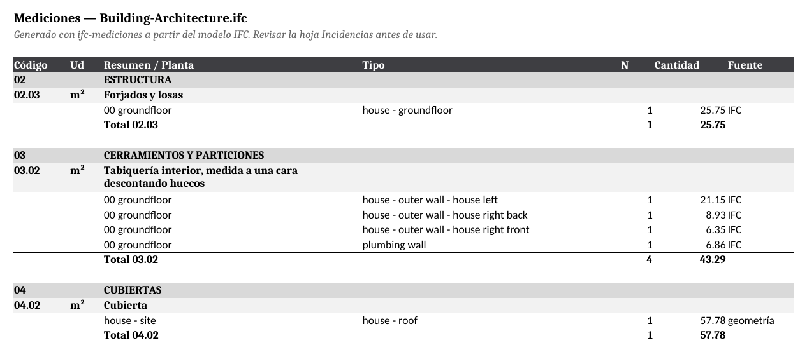

# ifc-mediciones

**From an IFC model to a bill of quantities, where every number says where it came from and anything doubtful is flagged for review.**

A bill of quantities lists every line item of a project with its unit and quantity, grouped into chapters. In Spain it's called *mediciones*, and its line items *partidas*; the output keeps those Spanish labels so it can go straight into a Spanish budget. It's the basis for the budget, for tenders and for certifying work on site. When the quantities come from a BIM model, the usual problem isn't extracting the numbers. It's knowing which ones to trust.

I built this small tool to automate that first takeoff. It doesn't hide the model's problems. It puts them on a list.



## What it does

1. **Reads the model** (IFC2x3, IFC4, IFC4.3) and converts all quantities to metric units, whatever the model's units are (mm, m, feet).
2. **Assigns each element to a *partida*** using a plain YAML rules file. Rules can filter by IFC class, `PredefinedType`, `IsExternal` and type name, so you can adapt them to your own budget structure without touching code.
3. **Takes each quantity from the model's own IFC quantities** (`NetSideArea`, `NetVolume`...). If the model has none, it **falls back to geometry** and says so.
4. **Groups the result the way a bill of quantities is read**: chapter → *partida* → one line per storey and element type.
5. **Writes an Excel file with four sheets**:
   - **Mediciones**: the document itself, with subtotals per *partida*
   - **Resumen**: one line per *partida*
   - **Detalle**: one line per element, with its `GlobalId`, so any number can be traced back to the model
   - **Incidencias**: everything that needs a human look

## What gets flagged

| Incidencia | Meaning |
|---|---|
| `MEDICION_BRUTA` | Net quantity missing, gross used instead (openings not deducted) |
| `NOMBRE_NO_ESTANDAR` | Quantity with a non-standard name, e.g. `GorssVolume`, used but flagged |
| `DESDE_GEOMETRIA` | No IFC quantity; calculated from the geometry |
| `DISCREPANCIA` | With `--verificar`: IFC quantity and geometry differ by more than 10% |
| `MODELO_SOSPECHOSO` | Model-level problem, e.g. every wall marked as external |
| `EXTERIOR_DESCONOCIDO` | No `IsExternal` data, so façade vs. interior can't be decided |
| `CANTIDAD_CERO` | Zero quantity (often broken geometry) |
| `SIN_PLANTA` / `SIN_PARTIDA` / `SIN_CANTIDAD` | Element without storey, without a rule, or without any usable quantity |

## Tested on real models

I ran it on three public models from the [opensourceBIM IFC library](https://github.com/opensourcebim/ifc-files) (not included in this repo because of their license). These are the kinds of issues it surfaced:

- **HHS Office, architecture** (IFC2x3, Revit export, millimetres): 396 elements in 5 *partidas*. **All 112 walls are marked `IsExternal = true`**, including toilet partitions, so a façade/interior split based on that flag would be wrong. The 33 curtain walls have no quantities and no geometry of their own, so they're measured by summing their panels.
- **HHS Office, structure** (IFC2x3): **31 elements where the exported quantity doesn't match the geometry.** For example, one wall exports `GrossSideArea` 85.9 m² while its geometry gives 27.7 m², and its own Length × Width × Height agrees with the geometry. 3 walls have broken geometry and come out as zero.
- **Schultz Residence** (IFC2x3, feet, no quantities at all): 535 elements measured from geometry, each one flagged `DESDE_GEOMETRIA`.

**How far can you trust the geometry fallback?** Where both sources exist, I compared it against the IFC quantities:

| Element | Compared with | Within 5% |
|---|---|---|
| Columns (257) | `GrossVolume` | 100% |
| Slabs (75) | `CrossArea` | 97% |
| Walls (112) | `GrossSideArea` | 87% (the rest are lower because geometry deducts openings) |
| Railings | `Length` | not reliable yet, see limitations |

## Usage

```bash
pip install -e .            # Python 3.10+
ifc-mediciones model.ifc -o mediciones.xlsx --verificar
```

```
architect.ifc (IFC2X3): 396 elementos medidos en 5 partidas
  02.03   Forjados y losas                         4,331.80 m2
  03.01   Muro de fachada, medido a una cara ...   2,593.12 m2
  03.03   Muro cortina                             2,607.40 m2
  05.01   Puertas                                    133.00 ud
  06.01   Falso techo                              1,755.44 m2
Incidencias: DESDE_GEOMETRIA 33, DISCREPANCIA 17, MEDICION_BRUTA 230, MODELO_SOSPECHOSO 1, SIN_PARTIDA 1
```

Options: `--reglas my_rules.yaml` for your own rules, `--csv summary.csv` for a CSV summary, `--tolerancia 0.05` to change the discrepancy threshold.

## Rules

The default rules are in [`ifc_mediciones/config/partidas.yaml`](ifc_mediciones/config/partidas.yaml). The first rule that matches wins:

```yaml
- codigo: "03.01"
  capitulo: "03"
  resumen: Muro de fachada, medido a una cara descontando huecos
  unidad: m2
  clases: [IfcWall]
  exterior: true                              # Pset_WallCommon.IsExternal
  cantidades: [NetSideArea, GrossSideArea]    # in order of preference
  geometria: side_area                        # fallback if there are no quantities
```

`tipo_regex` matches on the element's type name. That's useful when a model uses one IFC class for several things, for example to separate plasterboard partitions from brick ones.

## Limitations

This is a first version, and these are known gaps:

- **Measurement criteria are simplified.** Real *criterios de medición* have rules like "deduct openings larger than 4 m²". The tool deducts all openings when the net quantity exists, and none when it doesn't.
- **Geometry lengths are bounding-box lengths.** That's fine for straight elements but underestimates sloped railings.
- **Classification depends on how the model was authored.** If walls aren't marked `IsExternal`, the façade/interior split falls back to the general rule, and it's flagged.

## Next steps

- [ ] BC3 / FIEBDC-3 export, so the result opens directly in Presto or Arquímedes
- [ ] Measurement criteria per *partida* (opening deduction thresholds)
- [ ] Classify walls as exterior/interior from geometry when the property is missing
- [ ] AI-assisted mapping of type names to *partidas*, tested against a hand-checked set

## Tests

```bash
pip install -e ".[dev]"
pytest
```

The tests use the buildingSMART sample files in `tests/data`. They check that quantities match the model's own values, that the IFC2x3 and IFC4 versions of the same building give the same totals, that the geometry fallback agrees with the IFC quantities, and that misspelled or gross quantities are flagged.

## Credits

Test models in `tests/data` © buildingSMART International Ltd., [CC BY 4.0](http://creativecommons.org/licenses/by/4.0/), from [buildingSMART/Sample-Test-Files](https://github.com/buildingSMART/Sample-Test-Files). IFC parsing and geometry by [IfcOpenShell](https://ifcopenshell.org).

MIT License · Mauricio Ceniceros · [mauceniceros.com](https://www.mauceniceros.com)
